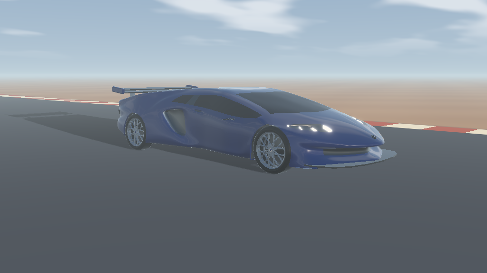
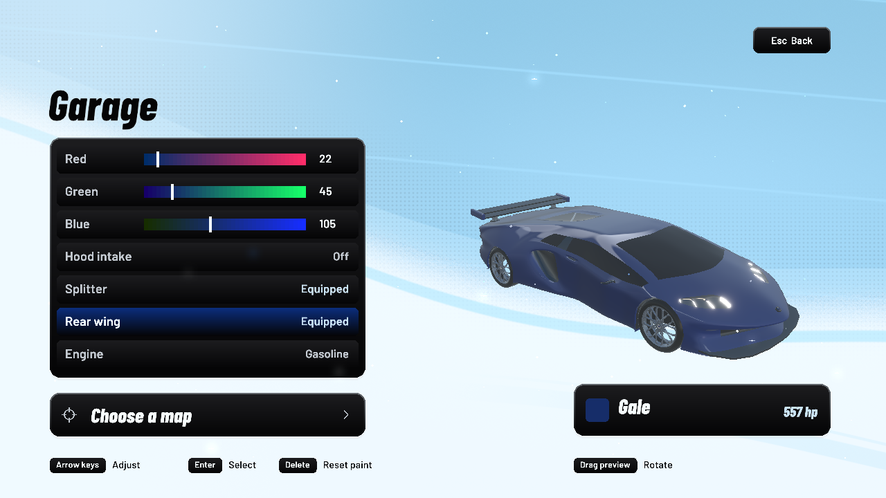
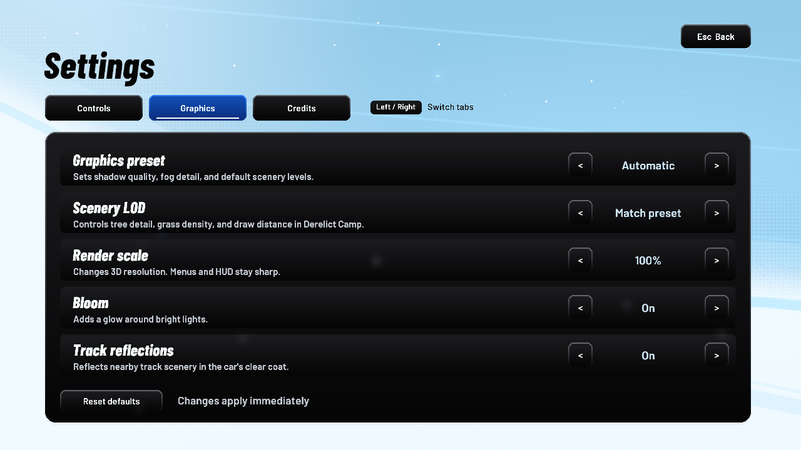

# MMORP Racer

A WIP multiplayer party racing game set in the MMORP universe. Planned targets are WebAssembly, Wii U, and native PC with advanced graphics.

## Garage

Choose either car under **Play** to open its garage. Adjust the RGB sliders with the mouse or arrow keys and toggle the hood intake, splitter, rear wing, and turbo diesel swap. The intake adds 3% power. The splitter and wing increase grip at speed and add drag. Each car's setup is saved when you leave the garage.

Drag the preview or use the look controls to orbit the car. The default look controls are the right stick or **I**, **J**, **K**, and **L**.

Hold the service brake and throttle to rev while parked. In Derelict Camp, aim a nearby exhaust outlet at the grass to see it bend. Gasoline cars spit flames on high-RPM shifts under throttle. Floor the diesel from low boost to roll coal, and watch the boost gauge as the turbo spools.

## Derelict Camp trees

Select **Play → Derelict Camp** for the endless mountain road. It starts at night. **N** toggles daylight on the default keyboard layout.
Wind-swept grass is sparse in the distance and fills in near the car. It recovers after the tires flatten it. On Windows, Automatic chooses a preset from CPU threads, system RAM, and graphics memory. WebGL defaults to Low.

Choose a graphics preset, scenery LOD, render scale, bloom, or track reflections under **Settings → Graphics**. Track reflections use nearby visible scenery and fall back to the sky and track colors. Headlights turn on at night, and rear lights cast a red glow when the car brakes or drives at night. With High scenery LOD, the landscape extends to 1.59 km and scattered grass to 315 m. The High graphics preset uses two 4096×4096 shadow maps for near and distant shadows.

Export the three tree levels from Blender as `assets/camp-tree-lod0.glb`, `assets/camp-tree-lod1.glb`, and `assets/camp-tree-lod2.glb`. Use the same size and origin at the base of the trunk for all three, with **Y Up** and **Apply Modifiers**. Bake foliage to an embedded PNG base-color texture and use glTF alpha **Mask** for cutout branches. A missing level uses the next coarser mesh when available, or a cube tree. The browser build includes LODs 1 and 2. Rebuild to include new exports.
